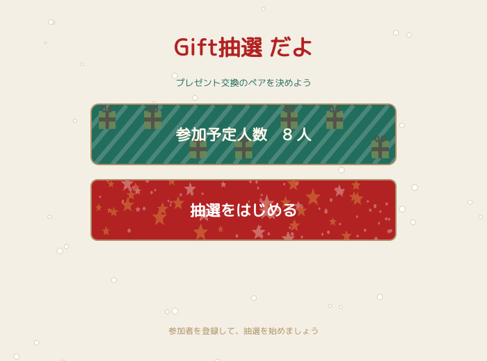
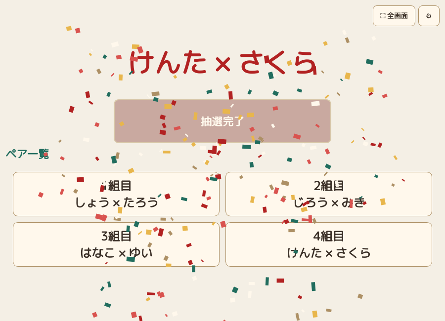

# Gift Exchange（ギフト交換 抽選アプリ）

プレゼント交換のペアを抽選する Windows 用デスクトップアプリです。
参加者を登録して「抽選をはじめる」を押すと、名前がスロットのように回り、1 組ずつペアが決まります。プロジェクターに映して盛り上げることを想定しています。

A Windows desktop app that randomly draws gift-exchange pairs, designed to be shown on a projector at parties.




## 主な機能

- 参加者の登録・名前の変更・削除（データは PC 内に保存）
- スロット風の抽選演出（演出時間は 1〜10 秒で変更可）
- ペア確定時のクラッカー（紙吹雪）演出と、背景の雪
- 結果画面の全画面表示（F11）
- 人数が奇数・2 人未満のときは抽選前にお知らせ
- 抽選は毎回ランダム（Mulberry32 + 32 ビットのランダムなシード）

## ダウンロード

最新版は [Releases](https://github.com/tsuyoshi1840/gift_exchenge/releases/latest) からダウンロードできます。

- [GiftExchange_Setup.exe](https://github.com/tsuyoshi1840/gift_exchenge/releases/latest/download/GiftExchange_Setup.exe)（インストーラー版）
- [GiftExchange_Portable.zip](https://github.com/tsuyoshi1840/gift_exchenge/releases/latest/download/GiftExchange_Portable.zip)（インストール不要版。展開して `GiftExchange.exe` を起動）

対応 OS：Windows 10 / 11（64 ビット）

## 使い方

1. 緑の「参加予定人数」ボタンを押して、参加者の名前を登録します（名前をクリックすると変更・削除）
2. 赤の「抽選をはじめる」ボタンを押します
3. 結果画面で「抽選開始」を押すたびに 1 組ずつペアが決まります
4. 右上の「⛶ 全画面」（または F11）でプロジェクター向けの全画面表示、Esc で元に戻ります

参加者データは `%APPDATA%\GiftExchange\participants.json` に保存されます。アプリはネットワーク通信を行いません。

## ソースから動かす・ビルドする

```powershell
pip install -r requirements.txt
python main.py
```

EXE とインストーラーの作り方は [BUILD.md](BUILD.md) を参照してください。
タグ（例：`v1.26.11.3`）を push すると、GitHub Actions（[release.yml](.github/workflows/release.yml)）が EXE とインストーラーをビルドして Release に添付します。

## Code signing policy

Free code signing provided by [SignPath.io](https://about.signpath.io/), certificate by [SignPath Foundation](https://signpath.org/).
Details: [CODE_SIGNING_POLICY.md](CODE_SIGNING_POLICY.md)

※ 現在 SignPath Foundation に申請中です。承認されるまで、配布物は署名されていません（Windows の警告が出ることがあります）。

## ライセンス

[MIT License](LICENSE)

同梱フォント M PLUS Rounded 1c は SIL Open Font License 1.1 です（[assets/fonts/OFL.txt](assets/fonts/OFL.txt)）。
